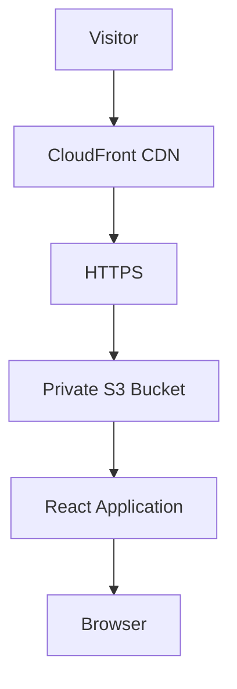

# Personal Portfolio — Architecture

## 1. Overview

Personal Portfolio is a static, bilingual and responsive
web application developed to present professional experience,
software engineering projects, academic background and research.

The application is built with React, TypeScript, Vite
and Tailwind CSS.

The infrastructure uses Amazon S3 and Amazon CloudFront.

## 2. System Architecture

## 3. Frontend Architecture

The application follows a modular architecture.
Application

- App.tsx
- Router
- Providers
- Global configuration
  Components
  Reusable interface components.
- Common
- Layout
- Projects
  Sections
  Independent portfolio sections.
- Hero
- About
- Skills
- Projects
- Education
- Experience
- Research
- Contact
  Pages
- HomePage
- ProjectDetailsPage
- NotFoundPage
  Data
  Typed information separated from presentation.
- Profile
- Projects
- Skills
- Education
- Experience
- Research
  Internationalization
  i18next manages Spanish and English translations.
  Theme
  ThemeProvider supports:
- Light
- Dark
- System
  Preferences are persisted locally.

## 4. Routing

React Router manages navigation.

Main routes:

- /
- /projects/workflow-saas
- /projects/medlab-platform
- /projects/instrumenthub
- /projects/digital-thermometer
- /projects/fbg-sensor-research
  Unknown routes display the 404 page.

CloudFront provides SPA fallback configuration.

## 5. SEO

SEO features include:

- Dynamic page titles.
- Meta descriptions.
- Canonical URLs.
- Open Graph metadata.
- Twitter Cards.
- robots.txt.
- sitemap.xml.
  SEO resources are generated during production builds.

## 6. Infrastructure

Amazon S3
Stores static application files.

The bucket remains private.
Amazon CloudFront
Provides:

- HTTPS.
- Global content delivery.
- Caching.
- SPA route handling.
- Cache invalidation.
  Origin Access Control
  Restricts access to the S3 origin.

## 7. Deployment

Deployment is performed manually using AWS CLI.

The process includes:

1. Authentication.
2. Quality checks.
3. Unit testing.
4. E2E testing.
5. Production build.
6. Release validation.
7. S3 synchronization.
8. CloudFront invalidation.
9. Production smoke tests.

## 8. Security

Security principles:

- Private S3 bucket.
- Block Public Access.
- CloudFront OAC.
- HTTPS.
- Temporary AWS credentials.
- No permanent credentials in Git.
- Minimum IAM permissions.

## 9. Architecture Decisions

- Static frontend without a backend.
- No production database.
- No unnecessary server infrastructure.
- Typed local project data.
- Manual AWS deployment.
- Oxlint instead of ESLint.
- Prettier for formatting.
- Vitest and Playwright for testing.
