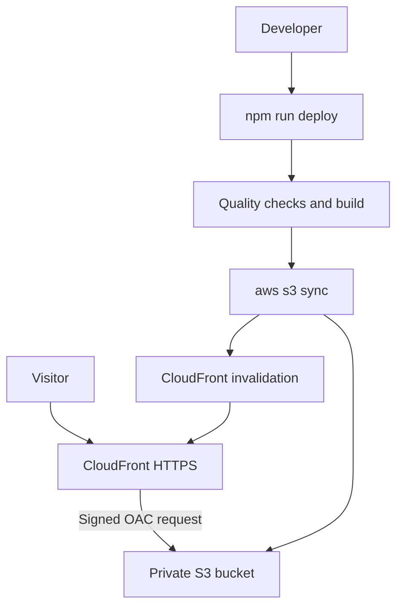

# AWS Production Architecture

Personal Portfolio is a static web application served through
Amazon CloudFront from a private Amazon S3 bucket.

## Infrastructure

- Amazon S3: private static asset storage.
- Amazon CloudFront: global CDN with HTTPS.
- Origin Access Control (OAC): signed CloudFront-to-S3 requests.
- AWS CLI: manual deployments with temporary credentials (`aws login`).

## Architecture

## Security

- S3 Block Public Access enabled, ACLs disabled.
- Bucket policy restricted to one CloudFront distribution ARN.
- HTTPS enforced for visitors.
- No permanent AWS credentials stored: deployments use
  short-lived credentials from `aws login`.
- No WAF: not required for a static site; avoids extra cost.

## Routing and caching

- React Router routes: CloudFront custom error responses
  (403/404) return `index.html` with HTTP 200.
- `index.html`: `no-cache,max-age=0,must-revalidate`.
- `assets/*`: `public,max-age=31536000,immutable`.
- `images/*`, `documents/*`: `public,max-age=86400`.
- `robots.txt`, `sitemap.xml`: `public,max-age=300`.

## Environment

- AWS Region (bucket): us-east-2
- Build tool: Vite
